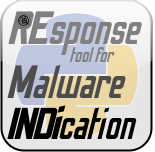

# REMINDer

<p align="center"></p>

**REMINDer** (*REsponse tool for Malware INDication*) detects whether an
executable is packed using a simple heuristic on the entropy of its entry
point section. It implements the method of Han et al. in
[*Packed PE File Detection for Malware Forensics*](https://ieeexplore.ieee.org/document/5404211)
as a Python package with a console script.

[](https://pypi.python.org/pypi/reminder-detector/)
[](https://pypi.python.org/pypi/reminder-detector/)
[](https://github.com/packing-box/reminder/actions/workflows/python-package.yml)
[](https://pypi.python.org/pypi/reminder-detector/)

## Features

- **One fast heuristic** (see [How it works](internals.md)): an executable is
  packed when its entry point section is writable and its entropy is above a
  threshold.
- **Three executable formats**: PE, ELF and Mach-O, parsed with
  [LIEF](https://github.com/lief-project/LIEF).
- **Configurable**: the entropy threshold can be tuned.
- **A command-line tool**, [`reminder`](cli/reminder.md), and a
  [Python API](api.md).

## Quick start

```console
$ pip install reminder-detector
$ reminder calc_packed.exe
True
$ reminder /bin/ls
False
```

From Python:

```python
from reminder import REMINDer

print(REMINDer().detect("program.exe"))  # True, False or "?"
```

## Related projects

REMINDer is part of the [packing-box](https://github.com/packing-box) ecosystem:

- [Awesome Executable Packing](https://github.com/packing-box/awesome-executable-packing): a curated list of resources about executable packing.
- [Bintropy](https://github.com/packing-box/bintropy): estimates how likely a binary is to contain compressed or encrypted bytes.
- [Dataset of packed ELF files](https://github.com/packing-box/dataset-packed-elf) and [Dataset of packed PE files](https://github.com/packing-box/dataset-packed-pe).
- [Docker Packing Box](https://github.com/packing-box/docker-packing-box): a Docker image of packers and tools for building datasets of packed executables.
- [DSFF](https://github.com/packing-box/python-dsff): the DataSet File Format library.
- [PEiD](https://github.com/packing-box/peid): a Python implementation of the Packed Executable iDentifier.
- [PyPackerDetect](https://github.com/packing-box/pypackerdetect): a packing detector for PE files using several heuristics and PEiD signatures.

## License

REMINDer is released under the
[GNU General Public License v3 or later](https://www.gnu.org/licenses/gpl-3.0.html).
